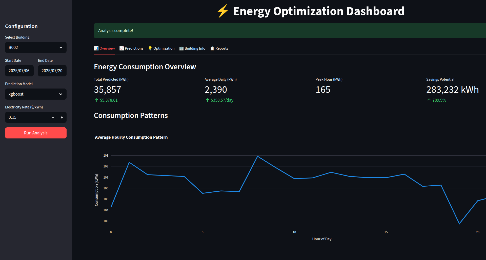
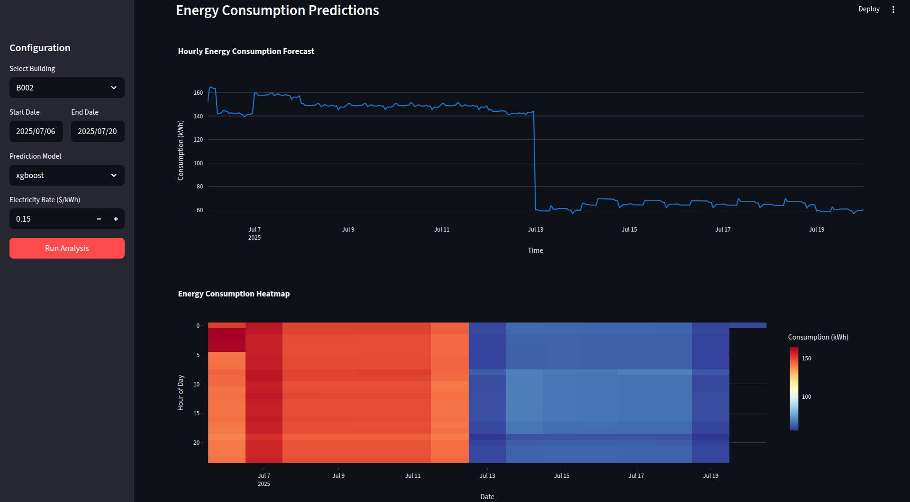
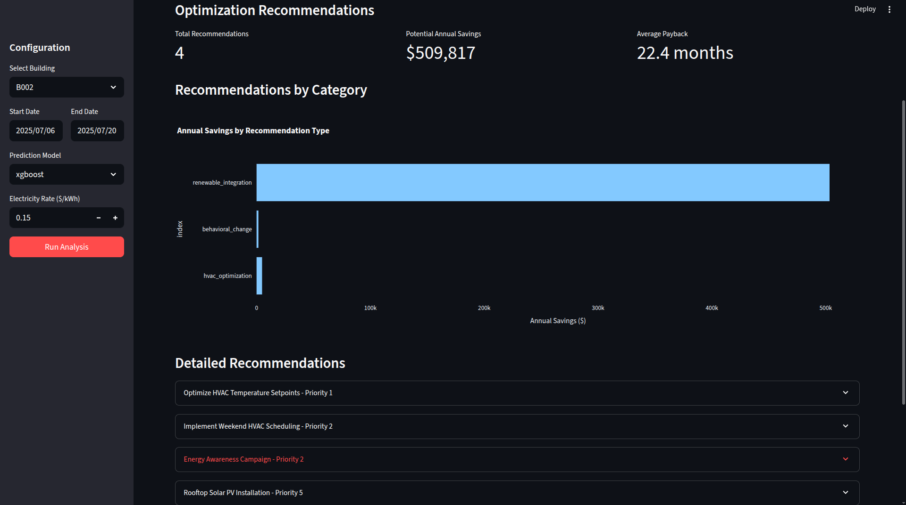
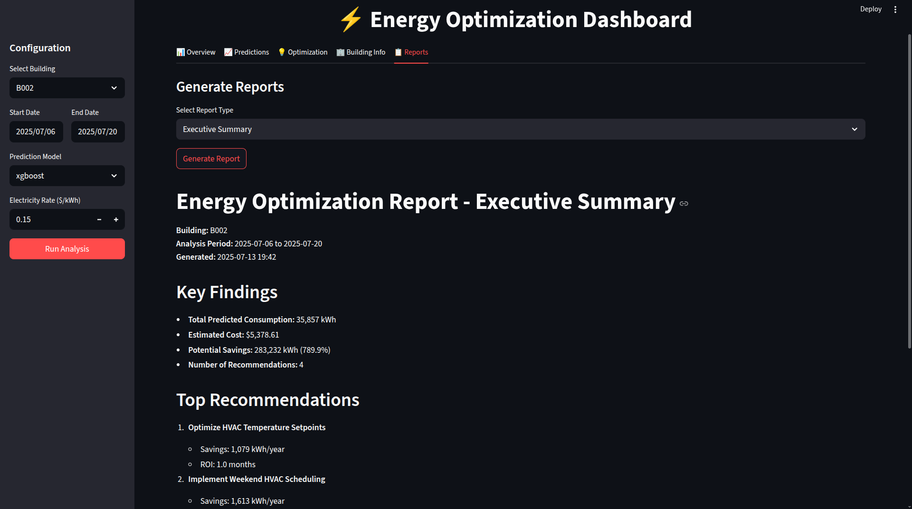

# LoadLens: Building Energy Forecasting & Analytics

Forecasts each building's hourly electricity use for the next 48 hours from real meter and weather data, tests it the way it would run in production, and translates the result into what a facility manager can act on: peak hours, the cost of forecast error, and what drives consumption.

[](https://github.com/etisamhaq/energy-optimization-ai-ml-project/actions/workflows/tests.yml)


**[See the interactive results →](https://energy-optimization-ai-ml-project.vercel.app/)** · **[Read the docs →](https://etisamhaq.github.io/energy-optimization-ai-ml-project/)**

## At a Glance

**Tested on real data:** 10 buildings in Washington, DC from the [Building Data Genome Project 2](https://github.com/buds-lab/building-data-genome-project-2), with real hourly weather. The models were trained on 2016 to mid-2017, then made **200 recursive 48-hour forecasts** (20 start dates per building, August–December 2017) on held-out data. No forecast sees the future.

| Model | Forecast error (WAPE) | 95% interval |
|---|---|---|
| **Ensemble** (XGBoost + LightGBM + Random Forest) | **8.2%** | 7.4–9.3% |
| Naive baseline (same hour last week) | 12.8% | 11.4–14.3% |

- The ensemble beats the baseline on **all 10 buildings** (per-building error 5.6%–22.5%). The improvement, 4.5 points, has a 95% interval of **3.5 to 5.7 points**, from bootstrapping whole forecasts.
- **The biggest win was a data fix, not a model change.** The first backtest showed the model barely beating the rule of thumb (12.9% vs 13.5%, interval crossing zero). Error analysis traced it to a shared meter-logger outage: four buildings read near zero for days at a time. `src/data/quality.py` now flags and repairs those readings before they reach training, forecasting or scoring.
- **Business view** (`make report`): daily peak-hour accuracy, the annual cost of forecast error under stated price assumptions, error by hour, horizon, day type and temperature, and SHAP explanations of what drives each forecast.
- **Savings recommendations** cover peak-load shifting, HVAC setpoints, start-up scheduling, LED and HVAC upgrades, and solar. These are **planning estimates, not measured savings**.
- **Production-ready serving:** FastAPI with API-key auth, rate limiting, readiness checks and Prometheus metrics; a Streamlit dashboard; Docker Compose; and a test suite run in CI on every push.

**Run it on real data:**

```bash
pip install -r requirements.txt -c constraints.txt && pip install -e .
make collect-real   # downloads BDG2 meters for 10 DC buildings (~175 MB, once) + Open-Meteo weather
make preprocess && make train
make backtest report   # 200-forecast backtest, error analysis, cost scenario, SHAP -> reports/
streamlit run src/visualization/dashboard.py
```

## Dashboard

*Screenshots show the synthetic demo dataset (`make collect-data`); real-data runs list BDG2 building IDs instead.*

| Overview | Forecasts |
|---|---|
|  |  |
| **Optimization** | **Report** |
|  |  |

## Problem Statement

Buildings account for roughly 30% of global final energy use and about a quarter of energy-related CO₂ emissions (IEA). This project addresses the need for energy management that can:

- Accurately predict energy consumption patterns
- Identify optimization opportunities
- Provide actionable recommendations for energy savings
- Scale from individual buildings to portfolios

## Project Structure

```
loadlens/
├── data/                # Data storage (raw, processed, external weather cache; not in git)
├── notebooks/           # EDA notebook + build_business_summary.py (business summary notebook)
├── src/
│   ├── data/            # BDG2 / Open-Meteo loaders, preprocessing, meter-outage repair (quality.py)
│   ├── features/        # Feature engineering and per-building target scaling
│   ├── models/          # XGBoost, LightGBM, Random Forest, ensemble; training and recursive forecasting
│   ├── evaluation/      # Backtest, business-impact report (errors, peaks, cost, SHAP), results-site builder
│   ├── optimization/    # Savings recommendations with stated assumptions
│   ├── api/             # FastAPI service (auth, rate limiting, metrics)
│   ├── visualization/   # Streamlit dashboard
│   └── utils/           # Helpers and configuration
├── reports/             # Backtest metrics, business metrics and figures (generated, committed)
├── site/                # Static results page served by Vercel (index.html + data.json)
├── models/              # Saved model artifacts (created by training; not in git)
├── tests/               # Unit and integration tests, run in GitHub Actions
├── vercel.json          # Serves site/ as a static page
└── requirements.txt     # Project dependencies
```

### Results page

The page at https://energy-optimization-ai-ml-project.vercel.app/ is static: it shows the saved backtest
results and runs no model. After re-running the backtest, rebuild its data and push:

```bash
make backtest report
python3 src/evaluation/build_site.py   # writes site/data.json
```

The SHAP step needs `pip install shap`. It uses exact TreeSHAP for XGBoost and LightGBM and the fast
Saabas approximation for the Random Forest, whose deep trees make exact SHAP take hours.

## Installation

1. Clone the repository:
```bash
git clone https://github.com/etisamhaq/energy-optimization-ai-ml-project.git
cd energy-optimization-ai-ml-project
```

2. Create a virtual environment:
```bash
python -m venv venv
source venv/bin/activate  # On Windows: venv\Scripts\activate
```

3. Install dependencies:
```bash
pip install -r requirements.txt -c constraints.txt
pip install -e .

# Optional: TensorFlow/PyTorch for the LSTM model
pip install -r requirements-dl.txt
```

4. Run the tests:
```bash
pytest
```

## Data Sources

The pipeline supports three sources (`src/data/collect_data.py --source ...`):

| Source | Energy data | Weather | Use for |
|--------|-------------|---------|---------|
| `bdg2` | **Real** hourly electricity meter readings, 2016–2017, from the [Building Data Genome Project 2](https://github.com/buds-lab/building-data-genome-project-2) (CC BY 4.0) | **Real**, from [Open-Meteo](https://open-meteo.com) for the site's coordinates | Evaluating the models on real buildings |
| `file` | **Your own** meter data and building metadata (CSV) | **Real**, from Open-Meteo for coordinates you give | Production |
| `synthetic` (default) | Generated | Generated | Demos and tests (no network needed) |

Building metadata (type, floor area, year built) comes with the BDG2 data or your metadata file.
BDG2 has no Energy Star scores for most buildings, so a neutral 50 is used.

Open-Meteo is free and needs no key. Weather forecasts reach 15 days ahead, which limits how far ahead predictions can go.

### Using your own data
- `energy.csv`: `building_id, timestamp, energy_consumption_kwh` (hourly, local time)
- `metadata.csv`: `building_id, building_type, floor_area_sqm, year_built, occupancy_type, hvac_type, energy_star_rating`

```bash
python src/data/collect_data.py --source file \
    --energy-file energy.csv --metadata-file metadata.csv \
    --latitude 38.90 --longitude -77.01 --timezone America/New_York
```

## Methodology

### 1. Data Pipeline
- Automated data collection from multiple sources
- Data quality checks and validation
- Feature engineering for temporal and contextual patterns

### 2. Model Architecture
- **Machine Learning**: XGBoost, LightGBM and Random Forest on time, weather, building and lag features
- **Ensemble**: Combination weighted by validation error
- **Per-building scaling**: Models predict consumption relative to each building's previous-week average, so one model serves buildings of very different sizes
- **Recursive forecasting**: Each hour's prediction feeds the next hour's lag features

`src/models` also contains Prophet, ARIMA and LSTM/GRU/Transformer classes. They are experimental and not
served by the training or prediction pipeline: they are fitted on all buildings at once and cannot
yet forecast an individual building.

### 3. Optimization Algorithm
- Peak load detection and shifting recommendations
- HVAC optimization based on occupancy patterns
- Cost-benefit analysis for energy-saving measures

## Usage

### Running the Data Pipeline
```bash
# Real data: 10 buildings in Washington, DC (downloads ~175 MB once)
python src/data/collect_data.py --source bdg2 --site Rat --n-buildings 10

# Or synthetic demo data
python src/data/collect_data.py --source synthetic

python src/data/preprocess.py
```

### Training Models
```bash
python src/models/train.py --model ensemble
```

### Making Predictions
```bash
# Forecasts start after the building's observed history (BDG2 data ends 2017-12-31)
python src/models/predict.py --building-id Rat_office_Colby --start-date 2018-01-01 --end-date 2018-01-07
```

### Running the API
```bash
uvicorn src.api.main:app --host 0.0.0.0 --port 8000
```
Interactive docs are served at http://localhost:8000/docs.

### Security and monitoring

| Setting | Purpose |
|---------|---------|
| `API_KEYS` | Comma-separated keys; clients send one in the `X-API-Key` header. **Unset disables authentication** (local development only). Docker Compose refuses to start without it. |
| `RATE_LIMIT_PER_MINUTE` | Requests per client per minute (default 60). Kept in memory per API process; with several replicas, also limit at the gateway. |
| `CORS_ORIGINS` | Comma-separated allowed browser origins. |
| `DATA_DIR`, `MODELS_DIR` | Where the API and dashboard read data and models. |

Endpoints without a key: `/health` (liveness), `/ready` (a model can be loaded, otherwise 503), `/metrics` (Prometheus: request counts, latency, predictions served) and `/docs`.

The dashboard and MLflow UI have no login. Docker Compose binds them to localhost; put them behind an authenticating reverse proxy before exposing them.

### Launching the Dashboard
```bash
streamlit run src/visualization/dashboard.py
```


## Performance Metrics

Measured on **real data**: 10 BDG2 buildings in Washington, DC, with real weather. The models were
trained on 2016 to mid-2017, then made 200 recursive 48-hour forecasts (20 start dates per building,
9 Aug to 30 Dec 2017) on held-out data. The error is WAPE: total absolute error divided by total
consumption. Hours where the meter itself had failed are not scored. `make backtest` reproduces this.

| Model | WAPE | 95% interval |
|-------|------|------|
| Ensemble (XGBoost + LightGBM + Random Forest) | **8.2%** | 7.4–9.3% |
| Naive baseline (same hour last week) | 12.8% | 11.4–14.3% |

The ensemble beats the baseline on all 10 buildings (per-building WAPE 5.6%–22.5%). Intervals come
from bootstrapping whole forecasts, since hours inside one forecast are not independent.

An earlier version of this README reported 17.4% vs 21.7% from 40 forecasts whose start dates were
not recorded. With 40 forecasts the result swung by several points depending on which dates were
picked, so the backtest is now committed code with 200 forecasts and confidence intervals.
Accuracy on your buildings will differ, so re-run this backtest on your own data before relying on the forecasts.

Predictions need at least one week of hourly history before the start date and must start within
14 days of the last reading; otherwise the API returns HTTP 400 with the reason.

### Optimization estimates
Savings use rule-of-thumb factors (HVAC share of load, LED savings, installation costs, ...) collected in
`DEFAULT_ASSUMPTIONS` in `src/optimization/optimizer.py`; override them with `EnergyOptimizer(assumptions={...})`
when you know a site's figures. Payback and ROI are calculated from those inputs, and every report includes
the assumptions it used. The confidence score is a heuristic rating, not a probability.

## Real-World Impact

- **Environmental**: Reduces carbon emissions by optimizing energy usage
- **Economic**: Lowers operational costs for building managers
- **Social**: Contributes to sustainable urban development
- **Scalability**: Applicable from individual buildings to entire cities

## Future Enhancements

- Integration with IoT sensors for real-time data collection
- Reinforcement learning for dynamic optimization
- Multi-building coordination for grid-level optimization
- Mobile application for building managers

## Contributing

We welcome contributions! Please open an issue or pull request.

## License

This project is licensed under the MIT License; see [LICENSE](LICENSE).

## Acknowledgments

- Building Data Genome Project 2: Miller, C. et al. *The Building Data Genome Project 2, energy meter data from the ASHRAE Great Energy Predictor III competition.* Scientific Data 7, 368 (2020). Licensed CC BY 4.0.
- Weather data by [Open-Meteo.com](https://open-meteo.com) (CC BY 4.0)
- Open-source ML community for tools and frameworks
